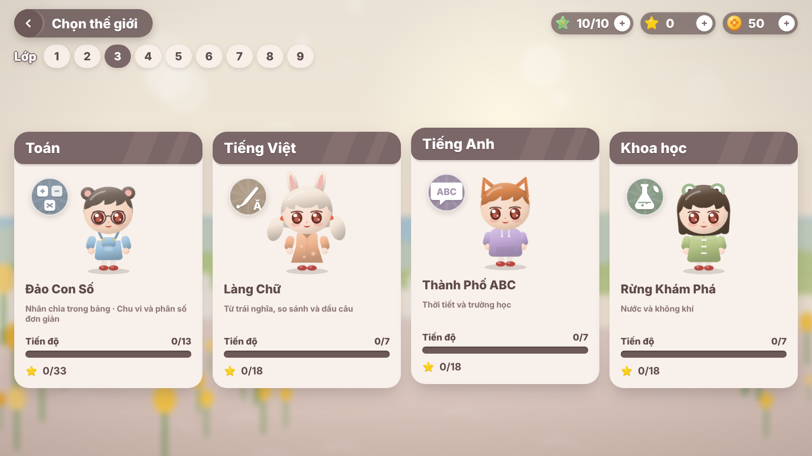
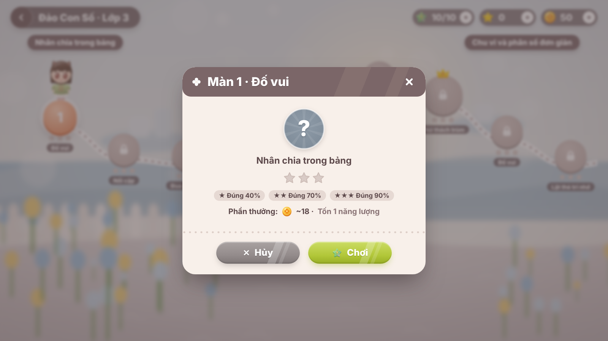

# 🌷 Bé Học Vui

Web game học tập **song ngữ Việt / Anh** cho học sinh **lớp 1 đến lớp 9**. Bộ môn gồm Toán, Tiếng Việt, Tiếng Anh và Khoa học. Giao diện theo phong cách casual mobile game: tông mauve và kem, nhân vật chibi, cảnh nền xoá phông.

Đây là bản hoàn chỉnh, gồm **cả frontend và backend**:

| Phần | Công nghệ | Ghi chú |
|---|---|---|
| Giao diện | React 18 + TypeScript + Vite, CSS thuần | Mọi hình (nhân vật, icon, cảnh nền) đều vẽ bằng SVG. Âm thanh tổng hợp bằng Web Audio. Không dùng asset bên ngoài |
| Máy chủ | Node.js thuần (`node:http`) | **Không cần cài thêm gói nào** |
| Cơ sở dữ liệu | SQLite qua `node:sqlite` có sẵn trong Node, hoặc **Turso** (SQLite đám mây) khi đưa lên web | Trên máy: lưu ở file `data/behocvui.db` |


---

## 1. Chạy nhanh (không cần cài gì thêm)

Yêu cầu duy nhất là **Node.js 22.13 trở lên** (khuyên dùng bản LTS mới nhất tại https://nodejs.org).

```bash
cd be-hoc-vui
npm start
```

Sau đó mở **http://localhost:5174**. Giao diện đã được build sẵn trong `client/dist`, nên không cần chạy `npm install`.

Lần đầu vào, phụ huynh có hai lựa chọn:
- **Đăng ký** tài khoản bằng email và mật khẩu.
- Bấm **"Chơi thử không cần tài khoản"**. Tài khoản khách có thể nâng cấp lên tài khoản email sau, trong Góc phụ huynh.

## 2. Phát triển (sửa giao diện có hot-reload)

```bash
npm install        # cài Vite, TypeScript, React (chỉ cần cho lúc phát triển)
npm run dev        # server API cổng 5174 + Vite cổng 5173 → mở http://localhost:5173
```

| Lệnh | Việc làm |
|---|---|
| `npm start` | Chạy server, phục vụ cả API lẫn giao diện đã build |
| `npm run dev` | Chạy chế độ phát triển (server tự khởi động lại, giao diện hot-reload) |
| `npm run build` | Build giao diện bằng Vite vào `client/dist` |
| `npm run build:fast` | Build nhanh bằng esbuild (phương án dự phòng) |
| `npm run typecheck` | Kiểm tra kiểu TypeScript |
| `npm test` | Chạy test server, gồm 5 nhóm (chi tiết ở mục 7) |

### Biến môi trường

| Biến | Mặc định | Ý nghĩa |
|---|---|---|
| `PORT` | `5174` | Cổng máy chủ |
| `DB_FILE` | `data/behocvui.db` | Vị trí file cơ sở dữ liệu |
| `COOKIE_SECURE` | — | Đặt `1` khi chạy sau HTTPS |
| `TZ_GAME` | `Asia/Ho_Chi_Minh` | Múi giờ dùng để tính "ngày học", chuỗi ngày và nhiệm vụ ngày |
| `DEMO_UNLOCK` | — | Đặt `1` để mở khoá mọi màn (dùng khi trình diễn hoặc khi giáo viên xem trước) |

Ví dụ trên Windows (PowerShell): `$env:DEMO_UNLOCK=1; npm start`

### Đưa lên web miễn phí

Dùng Render (máy chủ) và Turso (cơ sở dữ liệu), cả hai đều miễn phí. File `render.yaml` đã có sẵn. Hướng dẫn từng bước: **[docs/DEPLOY.md](docs/DEPLOY.md)**.

| Biến | Ý nghĩa |
|---|---|
| `TURSO_DATABASE_URL` | Khi có biến này, dữ liệu lưu trên Turso thay cho file SQLite trên máy |
| `TURSO_AUTH_TOKEN` | Token truy cập Turso |
| `TRUST_PROXY` | Đặt `1` khi chạy sau proxy (Render), để giới hạn đăng nhập sai tính đúng theo IP người dùng |

### Triển khai bằng Docker

```bash
docker build -t be-hoc-vui .
docker run -p 5174:5174 -v bhv-data:/app/data be-hoc-vui
```

Nên đặt sau một reverse proxy có HTTPS (Nginx, Caddy…) và bật `COOKIE_SECURE=1`. Muốn sao lưu thì chỉ cần chép thư mục `data/`.

---

## 3. Tính năng

**Cho bé**
- **Nhân vật chibi tuỳ biến**: kiểu tóc, màu tóc, tai thú (mèo, thỏ, gấu, cáo), trang phục (váy yếm, quần yếm, hoodie, áo dài, áo mưa), màu áo, phụ kiện (nơ, kẹp hoa, kính, nón lá, vương miện) và cảnh nền sảnh.
- **4 thế giới** học tập, mỗi thế giới có linh vật riêng: Đảo Con Số, Làng Chữ, Thành Phố ABC, Rừng Khám Phá.
- **Bản đồ màn chơi** theo từng lớp:
  - Các màn mở khoá lần lượt.
  - Có **rương báu** giữa chủ đề và **màn trùm** (3 tim) ở cuối.
  - Mỗi màn được chấm 1–3 sao.
- **12 loại game**:

  | Nhóm | Game |
  |---|---|
  | Chọn đáp án | Đố vui, Đúng/Sai (vuốt thẻ), Điền chỗ trống, Nghe và chọn (đọc bằng giọng máy) |
  | Kéo, ghép, xếp | Nối cặp, Lật thẻ trí nhớ, Sắp xếp, Ghép chữ (cả tiếng Việt có dấu), Xem đồng hồ (kéo kim) |
  | Hành động | Hứng đồ, Đua xe Toán, Bắn bóng bay |
- **Phần thưởng**: xu ảo, EXP và cấp độ, 22 huy hiệu, 3 nhiệm vụ mỗi ngày, rương mỗi ngày, cửa hàng đồ, chuỗi ngày học, bảng thi đua gia đình.
- **Hiệu ứng**: combo, pháo giấy, xu bay vào thanh tài nguyên, nhân vật có nhiều biểu cảm (vui, cổ vũ, vẫy tay, suy nghĩ, buồn nhẹ, ngủ).
- **Giao diện theo độ tuổi**: lớp 1–2 chữ to và tự đọc câu hỏi, lớp 3–5 chữ vừa, lớp 6–9 chữ gọn hơn.
- **Truy cập**: điều khiển được bằng bàn phím (phím 1–4, mũi tên, Enter), có chế độ giảm chuyển động. Giao diện chạy tốt trên điện thoại, máy tính bảng và máy tính.

**Cho phụ huynh** (vào qua cổng phép nhân)
- **Tài khoản**: tối đa 4 hồ sơ bé mỗi tài khoản. Có đổi mật khẩu và nâng cấp tài khoản khách.
- **Báo cáo**:
  - Số phút học 7 ngày (biểu đồ).
  - Độ chính xác theo môn.
  - Hoạt động gần đây.
- **Giới hạn**:
  - Thời gian học mỗi ngày (15–120 phút, hoặc không giới hạn).
  - Bật/tắt cơ chế năng lượng (giới hạn số màn chơi liên tục).
  - Bật/tắt bảng xếp hạng.
- Sửa và xoá hồ sơ. Xoá cần nhập lại mật khẩu.

**An toàn cho trẻ**
- Chỉ dùng biệt danh, có lọc từ ngữ không phù hợp.
- Không thu thập thông tin cá nhân của bé.
- Không quảng cáo, không thanh toán thật, không chat.
- Nhắc nghỉ mắt mỗi 20 phút.
- Server **tự chấm lại** mọi câu trả lời và tính phần thưởng, không tin điểm do trình duyệt gửi lên.

## 4. Nội dung

Nội dung bám theo Chương trình GDPT 2018 ở mức khái quát:

| Môn | Số chủ đề | Nguồn câu hỏi |
|---|---|---|
| Toán | 18 (2 chủ đề mỗi lớp) | **Bộ sinh câu hỏi theo seed**: mỗi lần chơi ra câu mới, đáp án nhiễu có chủ đích |
| Tiếng Việt / Ngữ văn | 9 | Ngân hàng câu hỏi soạn sẵn |
| Tiếng Anh | 9 | Ngân hàng câu hỏi soạn sẵn |
| Khoa học | 9 | Ngân hàng câu hỏi soạn sẵn |

Tổng cộng có 45 chủ đề, 256 màn chơi, 45 rương báu và 526 câu hỏi soạn sẵn (chưa tính câu Toán sinh tự động).

Cách thêm hoặc sửa câu hỏi: xem [docs/NOI_DUNG.md](docs/NOI_DUNG.md).

## 5. Cấu trúc thư mục

```
be-hoc-vui/
├── server/                 # Máy chủ (JavaScript thuần, không phụ thuộc gói ngoài)
│   ├── index.js            # Định tuyến API + phục vụ giao diện
│   ├── db.js               # Lược đồ SQLite
│   ├── auth.js             # Mật khẩu (scrypt) + phiên đăng nhập (cookie httpOnly)
│   ├── game.js             # Nghiệp vụ: tiến độ, năng lượng, chấm điểm, thưởng, huy hiệu, báo cáo
│   ├── rounds.js           # Tạo vòng chơi từ ngân hàng câu hỏi / bộ sinh
│   └── content/            # math.js (bộ sinh), bank.js (ngân hàng), index.js (môn, màn, cửa hàng, huy hiệu)
├── shared/logic.js         # Logic dùng chung client + server: chấm câu, sao, cấp, năng lượng, RNG
├── client/
│   ├── src/
│   │   ├── ui/             # kit.tsx (nút, panel, hộp thoại, HUD…), Chibi.tsx, Scene.tsx, Icons.tsx
│   │   ├── screens/        # Splash, Auth, Profiles, Lobby, Worlds/Map, Play, Character, Shop, Rewards, Parents…
│   │   ├── games/          # StepGames.tsx (9 game theo vòng), FlowGames.tsx (đua xe, bóng bay)
│   │   ├── lib/            # api, store, i18n (vi/en), sfx (âm thanh), speech (giọng đọc), fx (hiệu ứng)
│   │   └── styles.css      # Toàn bộ giao diện
│   └── dist/               # Bản build sẵn
├── test/server.test.js     # Test server
├── docs/                   # Tài liệu, ảnh mẫu phong cách, ảnh chụp màn hình
└── Dockerfile
```

## 6. API

Danh sách các endpoint: xem [docs/API.md](docs/API.md).

## 7. Kiểm thử

`npm test` gồm 5 nhóm:
1. **Mọi màn đều tạo được vòng chơi hợp lệ**: thử 25 seed cho mỗi màn, tổng hơn 10.000 vòng. Kiểm tra không có đáp án trùng, đủ bản dịch, và đáp án đúng luôn được chấm điểm tối đa.
2. **Đáp án Toán chính xác**: server tính lại từng phép tính để đối chiếu.
3. **Logic tính điểm**: sao, xu, cấp độ, năng lượng.
4. **Luồng API đầy đủ**:
   - Đăng ký, tạo hồ sơ, chơi hết các màn, nhận thưởng.
   - Chặn chơi lại màn đã đạt 3 sao để "cày" xu.
   - Mua đồ, mặc đồ, mở rương.
   - Báo cáo phụ huynh, giới hạn thời gian.
   - Đăng xuất, đăng nhập lại, tài khoản khách.
5. **Luồng API đầy đủ qua Turso**: chạy lại nhóm 4, nhưng lưu dữ liệu qua giao thức HTTP của Turso, trên một máy chủ giả lập.

## 8. Ảnh chụp màn hình

| | |
|---|---|
|  |  |
|  |  |
|  |  |
