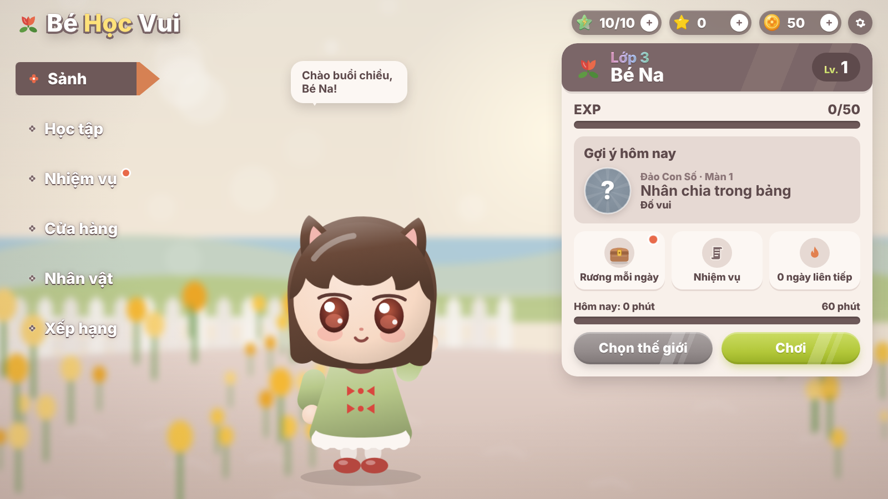
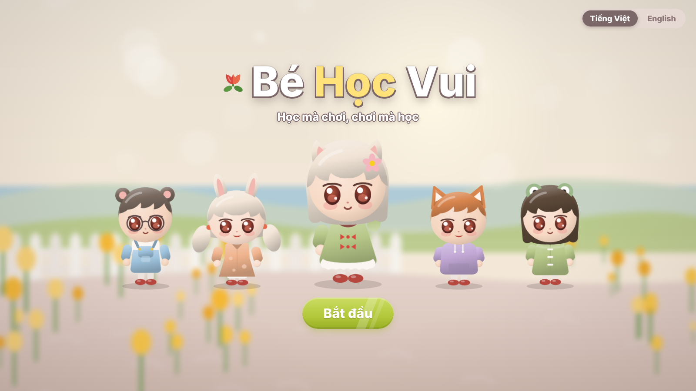
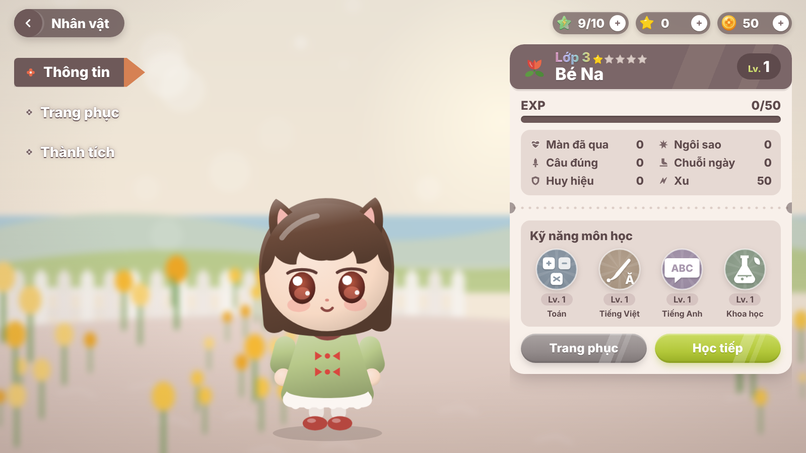
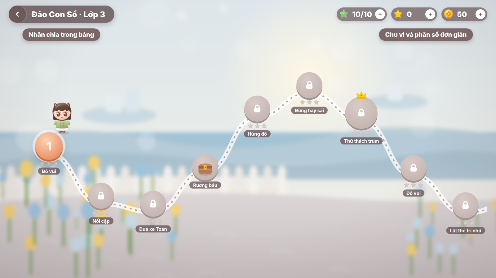
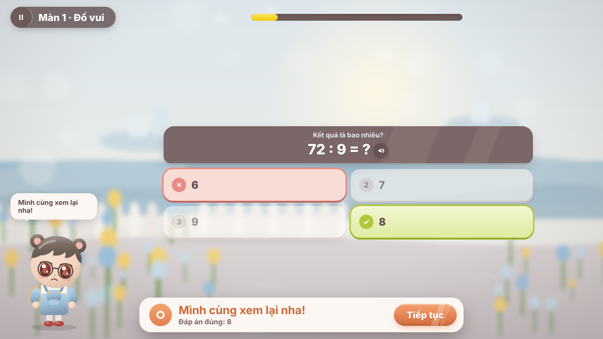
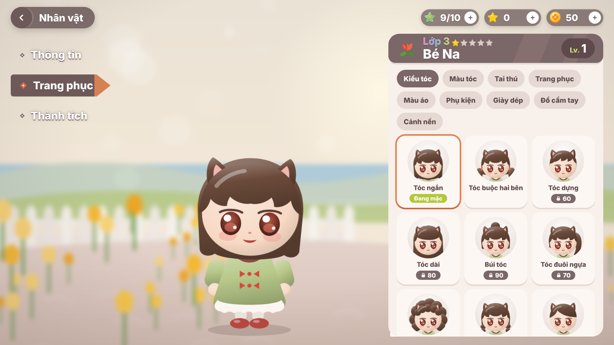

<div align="center">

# 🌷 Bé Học Vui

**Web game học tập song ngữ Việt – Anh cho học sinh lớp 1 đến lớp 9**

Toán · Tiếng Việt · Tiếng Anh · Khoa học — 609 chủ đề & chặng · hơn 5.100 màn chơi (trên 120 màn mỗi môn, mỗi lớp) · 19 loại game · Khu vui chơi mini game · 86 món thời trang



</div>

---

## Mục lục

1. [Giới thiệu](#1-giới-thiệu)
2. [Chạy thử trong 1 phút](#2-chạy-thử-trong-1-phút)
3. [Đưa lên web miễn phí](#3-đưa-lên-web-miễn-phí)
4. [Tính năng](#4-tính-năng)
5. [Tủ đồ thời trang](#5-tủ-đồ-thời-trang)
6. [Nội dung học](#6-nội-dung-học)
7. [Dành cho nhà phát triển](#7-dành-cho-nhà-phát-triển)
8. [Cấu trúc thư mục](#8-cấu-trúc-thư-mục)
9. [Câu hỏi thường gặp](#9-câu-hỏi-thường-gặp)

---

## 1. Giới thiệu

Bé Học Vui biến bài học thành những màn chơi ngắn từ 2 đến 5 phút.
- Bé chọn một "thế giới" (môn học), đi qua bản đồ màn chơi, trả lời câu hỏi để nhận sao và xu.
- Xu dùng để mua quần áo, phụ kiện cho nhân vật của mình.
- Phụ huynh có góc riêng để xem báo cáo và đặt giới hạn thời gian.

Giao diện theo phong cách **casual mobile game**:
- Tông màu nâu hồng (mauve) và kem.
- Nhân vật chibi kiểu búp bê vinyl.
- Cảnh nền mờ như chụp xoá phông.
- Nút viên thuốc có vệt sáng chéo.

Ảnh mẫu tham khảo nằm trong `docs/reference/`.

| Thành phần | Công nghệ |
|---|---|
| Giao diện | React 18 + TypeScript, CSS thuần. Nhân vật, icon, cảnh nền đều vẽ bằng SVG. Âm thanh tổng hợp bằng Web Audio |
| Máy chủ | Node.js thuần (`node:http`), **không phụ thuộc gói npm nào** |
| Cơ sở dữ liệu | SQLite (`node:sqlite` có sẵn trong Node) khi chạy trên máy, hoặc **Turso** (SQLite đám mây) khi đưa lên web |

---

## 2. Chạy thử trong 1 phút

Chỉ cần cài **[Node.js](https://nodejs.org) phiên bản 22.13 trở lên**.

```bash
cd be-hoc-vui
npm start
```

Mở trình duyệt vào **http://localhost:5174**.

- Không cần `npm install`, vì giao diện đã được build sẵn trong `client/dist`.
- Dữ liệu được lưu ở file `data/behocvui.db`.
- Ở màn đăng nhập có thể bấm **"Chơi thử không cần tài khoản"**. Tài khoản khách nâng cấp được lên tài khoản email sau, trong Góc phụ huynh.

---

## 3. Đưa lên web miễn phí

Dùng **Render** (máy chủ) kết hợp **Turso** (cơ sở dữ liệu). Cả hai đều miễn phí và không cần thẻ tín dụng. File `render.yaml` đã có sẵn.

| Bước | Việc cần làm |
|---|---|
| 1 | Đưa toàn bộ thư mục lên một repo **GitHub** |
| 2 | Tạo database trên **[turso.tech](https://turso.tech)**, chép **URL** (`libsql://…`) và **token** |
| 3 | Trên **[render.com](https://render.com)**: New → **Blueprint** → chọn repo. Để trống ô *Blueprint Path*, rồi dán URL và token vào 2 biến `TURSO_DATABASE_URL`, `TURSO_AUTH_TOKEN` |

Hướng dẫn chi tiết từng bước: **[docs/DEPLOY.md](docs/DEPLOY.md)**.

> Gói miễn phí của Render cho máy chủ "ngủ" sau 15 phút không ai truy cập. Lần mở kế tiếp phải chờ khoảng 30–60 giây. Dữ liệu vẫn an toàn vì nằm trên Turso.

---

## 4. Tính năng

### Cho bé
- 🗺️ **4 thế giới học tập**, mỗi thế giới có một linh vật dẫn đường:

  | Thế giới | Môn | Linh vật |
  |---|---|---|
  | Đảo Con Số | Toán | Bơ |
  | Làng Chữ | Tiếng Việt | Mochi |
  | Thành Phố ABC | Tiếng Anh | Foxy |
  | Rừng Khám Phá | Khoa học | Kiwi |
- 🧭 **Bản đồ màn chơi** theo từng lớp:
  - Các màn mở khoá lần lượt.
  - Giữa mỗi chủ đề có **rương báu**, cuối chủ đề là **màn trùm** (3 tim).
  - Mỗi màn được chấm 1–3 sao.
- 🎮 **16 loại game**:

  | Nhóm | Game |
  |---|---|
  | Chọn đáp án | Đố vui, Đúng/Sai (vuốt thẻ), Điền chỗ trống, Nghe và chọn |
  | Kéo, ghép, xếp | Nối cặp, Lật thẻ trí nhớ, Sắp xếp, Ghép chữ, Xem đồng hồ |
  | Hành động | Hứng đồ, Đua xe Toán, Bắn bóng bay |
  | Mini game (mới) | Chém trái cây (vuốt chém trái mang đáp án đúng), Xếp kẹo (ghép 3 viên cùng màu đáp án), Bắn ná (kéo ná bắn trúng thùng đáp án, có đường ngắm), Bé tập vẽ (tô theo nét để vẽ hình, viết số; máy đo độ phủ nét) |
- 🎡 **Khu vui chơi**: chơi tự do 7 mini game hành động. Bé chọn môn học, máy chủ lấy câu hỏi đúng lớp của bé. Không ảnh hưởng thứ tự mở màn trên bản đồ; vẫn tính xu, EXP, năng lượng và giới hạn thời gian mỗi ngày. Hình vẽ trong các mini game đều tự thiết kế, không dùng nhân vật của trò chơi khác.
- 🏆 **Phần thưởng**: xu, EXP và cấp độ, 24 huy hiệu, 3 nhiệm vụ mỗi ngày, chuỗi ngày học, bảng thi đua gia đình.
- 📅 **Điểm danh 7 ngày**: mỗi ngày vào sảnh sẽ hiện lịch điểm danh. Quà tăng dần từ 10 đến 60 xu kèm năng lượng, ngày thứ 7 tặng thêm một món đồ thời trang ngẫu nhiên. Bỏ lỡ một ngày thì chuỗi quay về ngày 1. Có huy hiệu cho 7 và 30 ngày điểm danh. Lịch sử điểm danh lưu trên máy chủ, nên đăng nhập ở máy khác vẫn giữ nguyên.
- 📱 **Giao diện điện thoại**: trên màn hình dọc, trang không cuộn. Nhân vật nằm trong khung cố định phía trên, chỉ phần nội dung bên dưới cuộn, nút chính luôn dính ở đáy. Bóng thoại đặt bên cạnh để không che nhân vật. Điện thoại xoay ngang dùng bố cục 2 cột.
- 👗 **Tủ đồ 86 món** để tự phối đồ cho nhân vật (xem [mục 5](#5-tủ-đồ-thời-trang)).
- ✨ **Hiệu ứng**:
  - Combo, pháo giấy, xu bay vào thanh tài nguyên.
  - Nhân vật có nhiều biểu cảm: vẫy tay, cổ vũ, suy nghĩ, buồn nhẹ, ngủ.
  - Âm thanh vui tai, giọng đọc câu hỏi.
- 🧒 **Giao diện theo độ tuổi**:
  - Lớp 1–2: chữ to, tự đọc câu hỏi.
  - Lớp 3–5: chữ vừa.
  - Lớp 6–9: chữ gọn.
- 📱 Dùng tốt trên điện thoại, máy tính bảng và máy tính.
- ⌨️ Điều khiển được bằng bàn phím (phím 1–4, mũi tên, Enter), có chế độ giảm chuyển động.

### Cho phụ huynh (vào qua cổng phép nhân)
- 👨‍👩‍👧 **Tài khoản**: tối đa 4 hồ sơ bé, đổi mật khẩu, **mã khôi phục** để tự đặt lại mật khẩu khi quên (không cần email; mã hiện một lần khi đăng ký, tạo lại được trong Góc phụ huynh), nâng cấp tài khoản khách (sảnh hiện nhắc "Lưu tiến độ" khi đang dùng tài khoản khách). Phiên đăng nhập giữ 60 ngày.
- 📊 **Báo cáo**: biểu đồ số phút học trong 7 ngày, độ chính xác theo từng môn, hoạt động gần đây.
- ⏱️ **Giới hạn**:
  - Thời gian học mỗi ngày (15–120 phút, hoặc không giới hạn).
  - Bật/tắt cơ chế năng lượng (giới hạn số màn chơi liên tục).
  - Bật/tắt bảng xếp hạng.
- ✏️ **Hồ sơ**: sửa biệt danh và lớp. Xoá hồ sơ cần nhập lại mật khẩu.

### An toàn cho trẻ
- Chỉ dùng biệt danh, có lọc từ ngữ không phù hợp. Không thu thập thông tin cá nhân của bé.
- Không quảng cáo, không thanh toán thật (xu chỉ là xu ảo), không chat.
- Nhắc nghỉ mắt mỗi 20 phút. Sau 21 giờ, linh vật nhắc bé đi ngủ.
- Máy chủ **tự chấm lại mọi câu trả lời** và tự tính phần thưởng, không tin điểm do trình duyệt gửi lên.

---

## 5. Tủ đồ thời trang

Nhân vật được dựng từ nhiều lớp SVG nên có thể phối tự do.
- Các món giá 0 xu có sẵn từ đầu. Các món còn lại mua trong **Cửa hàng** bằng xu kiếm được khi học.
- Trong Cửa hàng có thể **mặc thử** trước khi mua.
- Đồ đã có thay ở **Nhân vật → Trang phục**.

Cửa hàng có **4 cách mua sắm**:
- **Đồ lẻ** theo từng ô (tóc, tai thú, trang phục, phụ kiện…), lọc được theo **chủ đề**.
- **Combo**: cả bộ phối sẵn (vd. Phù thuỷ nhỏ, Ông già Noel nhí, Du xuân ngày Tết, Phi hành gia). Mua combo chỉ trả tiền những món còn thiếu, **rẻ hơn mua lẻ 20%**, mua xong mặc luôn cả bộ. Ở Tủ đồ có thẻ **Combo** để mặc lại cả bộ bằng một chạm.
- **Chủ đề (bộ sưu tập)**: mỗi món thuộc một chủ đề — Thường ngày, Đến trường, Nghề nghiệp, Cổ tích, Phiêu lưu, Muông thú, Thể thao, Vũ trụ, Mùa hè, Mùa đông, Việt Nam và 8 chủ đề ngày lễ.
- **Ngày lễ**: trong dịp lễ, đồ cùng chủ đề **giảm 30%**, combo giảm thêm, và mỗi bé nhận **1 món quà lễ** miễn phí (đã có rồi thì được 40 xu). Thẻ *Ngày lễ* trong Cửa hàng và chấm đỏ trên nút Cửa hàng báo khi có quà.

| Dịp lễ | Thời gian (giờ Việt Nam) | Quà |
|---|---|---|
| 🧧 Tết Nguyên Đán | 14 ngày trước → 7 ngày sau mùng 1 (âm lịch, có sẵn đến 2035) | Bao lì xì |
| 💝 Ngày yêu thương | 7–15/2 | Kẹp trái tim |
| 🌷 Quốc tế Phụ nữ / Phụ nữ Việt Nam | 1–9/3 và 13–21/10 | Bó hoa hồng |
| 🎈 Quốc tế Thiếu nhi | 25/5–3/6 | Chong chóng |
| 🏖️ Hè rực rỡ | 10/6–15/8 | Kem ốc quế |
| 🎒 Ngày khai trường | 25/8–8/9 | Cặp sách |
| 🇻🇳 Quốc khánh | 28/8–3/9 | Lá cờ Tổ quốc |
| 🏮 Tết Trung thu | 10 ngày trước → 3 ngày sau rằm tháng 8 (âm lịch) | Đèn ông sao |
| 🎃 Lễ hội bí ngô | 18/10–1/11 | Đèn bí ngô |
| 💐 Ngày Nhà giáo | 13–21/11 | Bó hoa tặng cô |
| 🎄 Giáng sinh | 10–31/12 | Kẹo gậy |

| Nhóm | Số món | Ví dụ |
|---|:---:|---|
| 💇 Kiểu tóc | 9 | Tóc ngắn, Buộc hai bên, Tóc dựng, Tóc dài, Búi tóc, Đuôi ngựa, Xoăn bồng, Tết hai bên, Tóc tém |
| 🎨 Màu tóc | 17 | Nâu ca cao, Đen, Kem sữa, Mật ong, Hồng phấn, Bạc hà, Trắng tuyết, Tím nho, Xanh đại dương, Vàng kim… |
| 🐾 Tai thú & sừng | 18 | Mèo, Thỏ, Gấu, Cáo, Gấu trúc, Hổ, Gấu túi, Ếch, Cú mèo, Sừng tuần lộc, Sừng kỳ lân, Sừng rồng, Tai tiên… |
| 👗 Trang phục | 46 | Áo dài, Áo bà ba, Áo dài Tết hoa mai, Áo cờ đỏ sao vàng, Đồ múa lân, Bác sĩ, Lính cứu hoả, Phi công, Hoạ sĩ, Hiệp sĩ, Pháp sư, Nàng tiên có cánh, Tiên cá, Siêu anh hùng, Cướp biển, Ninja, Khủng long, Ong, Phù thuỷ, Bí ngô, Ma cà rồng, Ông già Noel, Chú lùn, Người tuyết… |
| 🌈 Màu áo | 21 | Xanh lá mạ, Đào, Đỏ may mắn, Vàng kim, Cam bí ngô, Tím đêm, Xanh thông, Xanh hoàng gia… |
| 🎀 Phụ kiện | 35 | Nón lá, Khăn vấn Tết, Đầu lân, Mũ phù thuỷ, Mũ Noel, Mũ cử nhân, Mũ cứu hoả, Mũ phi công, Kính râm, Mặt nạ siêu nhân, Vòng hào quang… |
| 👟 Giày dép | 14 | Guốc mộc, Giày ba lê, Giày trượt patin, Chân vịt, Bốt lông, Giày pha lê, Giày chú lùn, Giày giáp… |
| 🌷 Đồ cầm tay | 30 | Đèn ông sao, Đèn cá chép, Bánh trung thu, Bao lì xì, Cành mai, Lá cờ, Đèn bí ngô, Chổi bay, Kẹo gậy, Hộp quà, Kiếm gỗ, Bóng đá… |
| 🏞️ Cảnh nền sảnh | 13 | Đồng hoa, Bờ biển, Đáy đại dương, Làng quê, Đêm sao, Lâu đài, Vũ trụ, Hoa anh đào, Tuyết, Phố hoa ngày Tết, Đêm rước đèn, Đêm bí ngô, Đêm Giáng sinh |

Tổng cộng **203 món**, **56 combo**, **19 chủ đề**. Ngoài ra bé chọn được **5 màu da** khi tạo nhân vật.

Muốn thêm món mới:
1. Khai báo món trong `SHOP` ở `server/content/shop.js` (kèm `tag` = chủ đề). Combo khai báo trong `COMBOS` cùng file.
2. Vẽ hình tương ứng trong `client/src/ui/Chibi.tsx` (cảnh nền: `client/src/ui/Scene.tsx`), đúng nhánh `switch` của nhóm.
3. Dịp lễ, mức giảm giá và cách tính giá combo nằm ở `shared/shop.js` (dùng chung cho máy chủ và giao diện).
4. Chạy `npm test` — có bài kiểm tra mọi combo, quà lễ và chủ đề đều trỏ đúng món.

---

## 6. Nội dung học

Bám theo Chương trình GDPT 2018 ở mức khái quát.

| Môn | Chủ đề | Nguồn câu hỏi |
|---|:---:|---|
| Toán | 45 (4 chủ đề + 1 bài ôn tập tổng hợp mỗi lớp): số học, hình học, đại số, toán có lời văn và toán nâng cao | **Sinh tự động theo seed**: mỗi lần chơi ra câu mới, đáp án nhiễu có chủ đích. Đề tự viết theo mẫu chương trình, không chép đề có bản quyền; đáp án được kiểm thử lại độc lập (giải phương trình, định lí Pythagore, phân tích nhân tử…) |
| Tiếng Việt / Ngữ văn | 18 | Ngân hàng câu hỏi soạn sẵn, có đọc hiểu với đoạn văn, đoạn thơ tự viết |
| Tiếng Anh | 18 | Ngân hàng câu hỏi soạn sẵn, có bài đọc tự viết |
| Khoa học | 18 | Ngân hàng câu hỏi soạn sẵn (song ngữ), có bài đọc khoa học |

Tổng cộng: 99 chủ đề soạn sẵn (1289 câu) + 510 chặng luyện tập sinh theo mẫu, hơn 5.100 màn chơi và 609 rương báu, cộng các ván mini game trong Khu vui chơi.

### Chủ đề giao diện và nhạc nền

Cài đặt → **Chủ đề giao diện & nhạc nền** có 5 chủ đề, mỗi chủ đề đổi bảng màu toàn app (biến CSS `[data-theme]`), phủ màu cảnh nền và phát một bản nhạc lặp liền mạch:

| Chủ đề | Nhạc (Pixabay) | File cần đặt trong `client/public/music/` |
|---|---|---|
| Xứ cổ tích (mặc định) | Fairy Tale Loop — SergeQuadrado | `fairy-tale-loop.mp3` |
| Lâu đài đêm | The Forgotten Keep (Night Version) — kaazoom | `forgotten-keep-night.mp3` |
| Đêm bí ngô | Halloween Horror Atmosphere — AlesiaDavina | `halloween-atmosphere.mp3` |
| Đảo thiên đường | Welcome To Paradise — SergeQuadrado | `welcome-to-paradise.mp3` |
| Suối rừng xanh | Water Streaming — Liecio | `water-streaming.mp3` |

Nhạc phát bằng Web Audio (tải một lần, trình duyệt lưu lại), chuyển chủ đề thì nhạc cũ nhỏ dần, nhạc mới to dần; ẩn tab thì tạm im. Thiếu file nào thì chủ đề đó dùng nhạc nhẹ tự tổng hợp. Giấy phép Pixabay Content License cho dùng miễn phí trong ứng dụng; không phát tán riêng các file nhạc.

### Chặng luyện tập sinh theo mẫu (`server/content/practice/`)

Để mỗi môn, mỗi lớp có trên 100 màn mà không phải soạn tay từng câu, câu hỏi được sinh từ **bảng dữ liệu + mẫu đề**:

- `engine.js` — bộ máy chung. Một *khái niệm* là một bảng (từ vựng, con vật, chất, tác phẩm…) cùng các mẫu câu: hỏi xuôi ("‘teacher’ nghĩa là gì?"), hỏi ngược ("Con vật nào đẻ trứng?"), đúng/sai, nối cặp, hứng đồ, sắp xếp, nghe chọn, ghép chữ, tự điền, điền chỗ trống. Cùng một mẫu được lặp lại ở nhiều màn với **đối tượng khác** (con vật, đồ vật, từ khác) và **số lượng khác** (3 hay 4 lựa chọn, 3–5 cặp, 4–7 mục hứng, số lớn dần).
- `en.js`, `vi.js`, `sci.js`, `math.js` — dữ liệu và mẫu đề từng môn, chia theo lớp 1–9 (khoảng 6 khái niệm mỗi lớp).
- `campaign.js` — dựng chặng: với mỗi lớp, mỗi môn có chặng cơ bản (bậc 1–2) cho từng khái niệm → Ôn tập 1 → chặng nâng cao (bậc 3–4) → Ôn tập 2. Mỗi chặng 9 màn (8 màn + màn trùm), game được chọn tự động trong số game mà khái niệm hỗ trợ và xoay vòng để các chặng liền nhau khác nhau.
- **Bậc khó** (1–4) đổi số lựa chọn, số cặp, độ lớn của số, và số vòng mỗi màn (bậc 4 nhiều hơn bậc 1 khoảng 70%). Mỗi lần chơi, máy sinh đề mới theo một hạt giống ngẫu nhiên.
- Các chặng luôn đứng **sau** các chủ đề cũ trên bản đồ, nên mã màn và tiến độ cũ của bé không đổi. Bản đồ có thanh chọn chặng để nhảy nhanh.
- Thêm một khái niệm mới chỉ cần thêm một bảng vào file của môn đó; bộ dựng chặng và bước rà lỗi tự động lo phần còn lại.

Các dạng đề: trắc nghiệm, đúng/sai, điền chỗ trống, nghe và chọn, nối cặp, lật thẻ, sắp xếp, ghép chữ, xem đồng hồ, hứng đồ, tô theo nét, **tự điền đáp án** (gõ chữ hoặc dùng bàn phím số; không phân biệt hoa thường, 0,5 = 0.5; quên dấu tiếng Việt được nửa điểm), **chọn nhiều đáp án** (phải chọn đủ, không thừa) và **đọc hiểu** (đoạn văn kèm câu hỏi). Chạy `npm run audit:content` để rà lỗi bộ đề tự động (lựa chọn trùng, thiếu bản dịch, câu trùng, đáp án không chấm được…); bộ kiểm thử cũng chạy bước này.

Các dạng Toán theo lớp:

| Lớp | Chủ đề |
|---|---|
| 1 | Cộng trừ trong phạm vi 10 · Đếm, so sánh số đến 100 · Hình vuông, tròn, tam giác (tô hình) · Tập viết số, tìm số còn thiếu |
| 2 | Bảng nhân 2 và 5 · Xem đồng hồ · Cộng trừ có nhớ trong phạm vi 100 · Bài toán có lời văn |
| 3 | Nhân chia trong bảng · Chu vi, phân số đơn giản · Diện tích hình chữ nhật, hình vuông · Nâng cao: bài toán hai bước tính |
| 4 | Số nhiều chữ số · Phân số · Góc nhọn/tù/bẹt, trung bình cộng · Nâng cao: tìm hai số khi biết tổng và hiệu |
| 5 | Số thập phân · Tỉ số phần trăm · Diện tích tam giác, hình thang, hình tròn, thể tích · Toán chuyển động đều |
| 6 | Số nguyên · Số nguyên tố, ƯCLN, BCNN · Luỹ thừa, thứ tự phép tính · Nâng cao: dãy số quy luật, dấu hiệu chia hết |
| 7 | Số hữu tỉ · Tỉ lệ thức · Biểu thức đại số, đa thức · Tổng ba góc của tam giác |
| 8 | Hằng đẳng thức · Phương trình bậc nhất · Định lí Pythagore · Phân tích đa thức thành nhân tử |
| 9 | Căn bậc hai · Hàm số bậc nhất, hệ phương trình · Phương trình bậc hai, định lí Viète · Tỉ số lượng giác, đường tròn |

Cách thêm hoặc sửa câu hỏi: **[docs/NOI_DUNG.md](docs/NOI_DUNG.md)**.

---

## 7. Dành cho nhà phát triển

```bash
npm install     # chỉ cần khi sửa giao diện (cài Vite, TypeScript, React)
npm run dev     # server API cổng 5174 + giao diện hot-reload cổng 5173 → http://localhost:5173
```

| Lệnh | Việc làm |
|---|---|
| `npm start` | Chạy server, phục vụ cả API lẫn giao diện đã build |
| `npm run dev` | Chạy chế độ phát triển |
| `npm run build` | Build giao diện bằng Vite vào `client/dist` (khi đưa lên Render, giao diện được build tự động) |
| `npm run build:fast` | Build nhanh bằng esbuild (phương án dự phòng) |
| `npm run typecheck` | Kiểm tra kiểu TypeScript |
| `npm test` | Chạy 19 nhóm kiểm thử máy chủ: luồng tài khoản, chấm điểm, nội dung (100 hạt giống mỗi màn), đáp án Toán giải lại độc lập, ca biên giờ Việt Nam, thử tấn công, sao lưu/khôi phục, Turso |
| `npm run test:ui` | Kiểm thử giao diện bằng Playwright: mọi màn ở 7 cỡ màn hình + chơi thử 22 loại trò chơi (cần `npm i --no-save playwright && npx playwright install chromium`) |
| `npm run backup` | Sao lưu toàn bộ dữ liệu (Turso hoặc file) ra `backups/*.json` — xem [docs/DEPLOY.md](docs/DEPLOY.md) |
| `npm run restore -- <file>` | Khôi phục từ file sao lưu (từ chối ghi đè database đã có dữ liệu, trừ khi thêm `--force`) |
| `npm run audit:content` | Rà soát tự động toàn bộ bộ đề, in danh sách câu lỗi |
| `npm run export:content` | Xuất mọi câu hỏi ra `docs/duyet-noi-dung.csv` để giáo viên duyệt |

### Biến môi trường

| Biến | Mặc định | Ý nghĩa |
|---|---|---|
| `PORT` | `5174` | Cổng máy chủ |
| `DB_FILE` | `data/behocvui.db` | File SQLite khi chạy trên máy |
| `TURSO_DATABASE_URL` | — | Khi có biến này, dữ liệu lưu trên Turso |
| `TURSO_AUTH_TOKEN` | — | Token truy cập Turso |
| `COOKIE_SECURE` | — | Đặt `1` khi chạy sau HTTPS |
| `TRUST_PROXY` | — | Đặt `1` khi chạy sau proxy (Render), để giới hạn đăng nhập sai tính đúng theo IP người dùng |
| `TZ_GAME` | `Asia/Ho_Chi_Minh` | Múi giờ dùng để tính "ngày học", chuỗi ngày và nhiệm vụ |
| `DEMO_UNLOCK` | — | Đặt `1` để mở khoá mọi màn (dùng khi trình diễn hoặc khi giáo viên xem trước) |
| `ADMIN_TOKEN` | — | Đặt một chuỗi bí mật để xem lỗi trình duyệt: gọi `GET /api/admin/errors` với header `x-admin-token` |

### Kiểm thử (`npm test`)
1. Mọi màn đều tạo được vòng chơi hợp lệ: thử 25 seed cho mỗi màn, tổng hơn 10.000 vòng. Kiểm tra không có đáp án trùng, đủ bản dịch Việt/Anh.
2. Đáp án Toán chính xác: test tính lại từng phép tính để đối chiếu.
3. Logic tính điểm: sao, xu, cấp độ, năng lượng.
4. Luồng API đầy đủ trên SQLite:
   - Đăng ký, tạo hồ sơ, chơi hết các màn, nhận thưởng.
   - Chặn chơi lại để "cày" xu.
   - Mua đồ, mở rương, báo cáo phụ huynh, giới hạn thời gian, đăng nhập lại.
5. Chạy lại nhóm 4 nhưng lưu dữ liệu qua giao thức HTTP của Turso (trên một máy chủ giả lập).

### Tài liệu khác
- [docs/API.md](docs/API.md): danh sách API và quy tắc tính thưởng.
- [docs/NOI_DUNG.md](docs/NOI_DUNG.md): thêm và sửa câu hỏi.
- [docs/DEPLOY.md](docs/DEPLOY.md): đưa lên web miễn phí.
- [docs/STYLE_NOTES.md](docs/STYLE_NOTES.md): bảng màu và hình khối lấy từ ảnh mẫu.

---

## 8. Cấu trúc thư mục

```
be-hoc-vui/
├── server/                 Máy chủ (JavaScript thuần)
│   ├── index.js            Định tuyến API + phục vụ giao diện
│   ├── db.js               SQLite trên máy / Turso qua HTTP
│   ├── auth.js             Mật khẩu (scrypt) + phiên đăng nhập (cookie httpOnly)
│   ├── game.js             Tiến độ, năng lượng, chấm điểm, thưởng, huy hiệu, báo cáo
│   ├── rounds.js           Tạo vòng chơi từ ngân hàng câu hỏi / bộ sinh
│   └── content/            math.js (bộ sinh), bank.js (ngân hàng), index.js (môn, màn, huy hiệu), shop.js (cửa hàng, combo, chủ đề)
├── shared/logic.js         Logic dùng chung client + server: chấm câu, sao, cấp, năng lượng
├── client/
│   ├── src/
│   │   ├── ui/             kit.tsx (nút, panel, hộp thoại, HUD), Chibi.tsx (nhân vật), Scene.tsx, Icons.tsx
│   │   ├── screens/        Các màn hình: chào, đăng nhập, sảnh, bản đồ, chơi, nhân vật, cửa hàng, phụ huynh…
│   │   ├── games/          StepGames.tsx (game theo vòng), FlowGames.tsx (đua xe, bóng bay)
│   │   ├── lib/            api, store, i18n (vi/en), âm thanh, giọng đọc, hiệu ứng
│   │   └── styles.css      Toàn bộ giao diện
│   └── dist/               Bản build sẵn
├── test/                   Bộ test
├── docs/                   Tài liệu, ảnh mẫu, ảnh chụp màn hình
├── render.yaml             Cấu hình triển khai Render
└── Dockerfile              Triển khai bằng Docker
```

---

## 9. Câu hỏi thường gặp

**Chạy `npm start` báo cần Node.js 22.13?**
Cài bản Node.js LTS mới nhất tại https://nodejs.org rồi mở lại cửa sổ dòng lệnh.

**Máy không đọc được câu hỏi tiếng Việt?**
Giọng đọc phụ thuộc vào thiết bị. Trên Windows, vào Cài đặt → Thời gian và ngôn ngữ → Giọng nói, rồi thêm giọng Tiếng Việt. Nếu máy không có giọng Việt, game "Nghe và chọn" có nút **Xem chữ** để thay thế.

**Muốn mở khoá hết màn để xem trước?**
Chạy server với `DEMO_UNLOCK=1`. Trên PowerShell: `$env:DEMO_UNLOCK=1; npm start`.

**Sao lưu dữ liệu thế nào?**
- Chạy trên máy: chép file `data/behocvui.db`.
- Chạy trên Turso: dùng tính năng sao lưu ngay trên trang quản lý của Turso.

---

## Ảnh chụp màn hình

| | |
|---|---|
|  |  |
|  |  |
|  |  |
